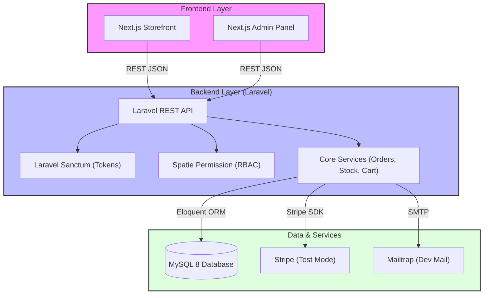

# Backend API Overview & System Architecture

## Project Overview
This repository contains the **Laravel** backend for an e‑commerce platform that powers a Next.js storefront and an admin panel. The backend is the single source of truth for all business logic, data persistence, authentication, authorization, payments, and integrations.

Key responsibilities include:
- **RESTful JSON API** consumed by the Next.js frontend.
- **User authentication** using Laravel Sanctum (separate guards for customers and staff).
- **Role‑Based Access Control (RBAC)** with granular permissions powered by `spatie/laravel-permission`.
- **Product, inventory, order, coupon, and shipping management**.
- **Stripe Test Mode** integration for secure payment processing.
- **Email notifications** via Mailtrap.
- **Comprehensive validation** and server‑side calculations to prevent tampering.

The architecture follows a decoupled full‑stack model: the frontend makes no direct database calls; all operations flow through the API.

---

## Technology Stack
| Layer | Technology |
|-------|------------|
| **Framework** | Laravel 12/13 (PHP) |
| **Auth** | Laravel Sanctum (Bearer tokens) |
| **RBAC / Authorization** | Spatie Laravel Permission (`spatie/laravel-permission`) |
| **Database** | MySQL 8 (Eloquent ORM) |
| **Payments** | Stripe PHP SDK (Test mode) |
| **Mail** | Mailtrap (local dev) |
| **API Docs** | Swagger/OpenAPI Markdown (included) |
| **Testing** | Pest (feature/unit tests – optional) |

---

## API Design Highlights
- **Versioned**: `/api/v1/...`
- **Consistent response envelope**:
  ```json
  {
    "success": true,
    "data": { ... },
    "error": null
  }
  ```
- **Standard HTTP status codes** for success, client, and server errors.
- **Pagination metadata** (`meta.total`, `meta.per_page`, `meta.current_page`).
- **Authentication**: `Authorization: Bearer <sanctum-token>` header.
- **Authorization**: Middleware checks permission strings like `products.create`.
- **Representative endpoints** (non‑exhaustive):
  - `GET /api/v1/products`
  - `POST /api/v1/cart/items`
  - `POST /api/v1/checkout`
  - `POST /api/v1/auth/login` (customer) / `POST /api/v1/admin/login`
  - `POST /api/v1/orders/{id}/cancel`
  - `GET /api/v1/dashboard/stats`

---

## System Architecture


---

## Folder Structure (backend)
```
backend/
├─ app/                # Laravel application code
│   ├─ Http/Controllers   # API endpoints
│   ├─ Models              # Eloquent models (User, Product, Order, ...)
│   ├─ Services            # Business‑logic services (CheckoutService, StockService)
│   └─ Policies            # Authorization policies
├─ database/          # Migrations & seeders
├─ routes/            # api.php (v1 routes)
├─ config/            # sanctum.php, stripe.php, etc.
└─ tests/             # Pest tests (optional)
```

---

## Installation Guide
1. **Clone the repository**
   ```bash
   git clone <repository-url>
   cd nocfinity-ecom-backend
   ```
2. **Install PHP dependencies**
   ```bash
   composer install
   ```
3. **Copy environment configuration**
   ```bash
   cp .env.example .env
   ```
4. **Generate application key**
   ```bash
   php artisan key:generate
   ```
5. **Configure database and other variables** in `.env` (DB credentials, Stripe keys, Mailtrap settings).
6. **Run migrations and seeders**
   ```bash
   php artisan migrate --seed
   ```
7. **Start the development server**
   ```bash
   php artisan serve --port=8000
   ```

After these steps the API will be reachable at `http://localhost:8000/api/v1/`.

---

## Security Considerations
- All monetary calculations are performed server‑side.
- RBAC is enforced via Spatie permission middleware (`permission:<permission_name>`); UI‑side element hiding is purely supplemental.
- CSRF protection for state‑changing routes when accessed via web guard.
- Rate limiting on login endpoints (throttle after 5 failed attempts).
- Sensitive secrets (Stripe keys, DB passwords) are never committed; they live in `.env`.

---

## Extending the Backend
- Add new **API resources** by creating a controller, request validation, and routes under `routes/api.php`.
- Extend **RBAC** by defining new permissions using Spatie (`Permission::create(['name' => '...', 'guard_name' => 'api'])`) in seeders and protecting routes via permission middleware or policies.
- For additional **integrations** (e.g., shipping providers), encapsulate logic in a service class and expose appropriate endpoints.

---

## License
MIT – see LICENSE file.
